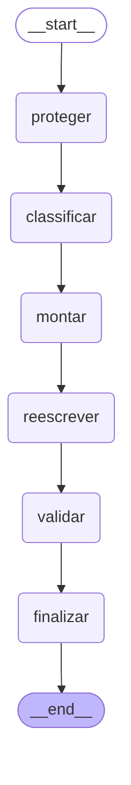

**Integrantes**

- Gabriel Barbosa Furin — RM 572941
- Lucas Kiodi Moraca — RM 571004
- Renan Fracalossi Mano da Silva — RM 569610

## 1. O que é

Um assistente que responde dúvidas sobre RG, CPF, título de eleitor, Carteira de Trabalho, certidões e CNH usando **somente** as 7 fichas da Central do Cidadão de Aurora (material fictício). Toda resposta cita a ficha e a data, avisa que não é canal oficial e não coleta nem guarda dados pessoais. Fora das fichas, diz que não encontrou e não inventa.

## 2. Arquitetura

Um único agente em **LangGraph**, com seis nós de função única (figura abaixo). Busca, regras, privacidade, detecção de injeção e citação são código comum (determinístico e testável). A IA (OpenAI, chave do professor, só por variável de ambiente) entra em três pontos: reescrever em linguagem simples os trechos já escolhidos, **validar** a resposta contra as fichas e julgar o golden dataset. A IA não pesquisa fora das fichas.

| Nó | Papel | Usa IA? |
|---|---|---|
| proteger | oculta CPF, telefone, e-mail etc.; valida entrada vazia, longa ou sem sentido; detecta prompt injection | não |
| classificar | escolhe a rota e busca ficha e seções | não |
| montar | monta a resposta com o texto da ficha | não |
| reescrever | simplifica a linguagem (com chave) | sim |
| validar | a IA confere a resposta contra as fichas (com chave) | sim |
| finalizar | acrescenta fonte, data e aviso; mascara dados pessoais na saída | não |

**Validação por IA:** se a resposta não for fiel às fichas, volta o texto da ficha; se for fiel mas não responder à pergunta, mostra a ficha inteira; se a chamada falhar, usa o texto da ficha. Sem chave, o assistente funciona só com a base.

## 3. Por que essas escolhas

- **LangGraph e não CrewAI:** o fluxo é uma sequência de passos com estado e caminhos diferentes (escopo, fora do escopo, dados pessoais, injeção); CrewAI serve a vários agentes que conversam, o que não é o caso.
- **Um agente só:** o domínio é pequeno (7 fichas). Vários agentes aumentariam custo e pontos de falha sem ganho.
- **Modelo pequeno (`gpt-4o-mini` por padrão, configurável):** a tarefa é reescrever trechos curtos e julgar respostas curtas. O nome do modelo é configurável (`OPENAI_MODELO`).
- **Privacidade:** sem histórico, arquivo, banco ou log; o LLM e o juiz só recebem texto já oculto.
- **Prompt injection:** mensagem e fichas são dados, não instruções; padrões de manipulação levam a uma recusa e, se a mensagem também perguntava algo das fichas, à resposta correta da ficha.

## 4. Avaliação

Golden dataset de 26 mensagens do enunciado, mais 14 perguntas próprias. Dois juízes: de **regras** (verificações objetivas sobre o texto) e **LLM** (confere o conteúdo por uma lista de pontos; o código confere fichas citadas e dados pessoais e calcula o veredito).

| | Versão 1 (antes) | Versão 2 (depois) |
|---|---|---|
| Juiz de regras, 26 mensagens | 12 corretas | 26 corretas |
| Juiz de regras, 14 perguntas próprias | — | 14 corretas |
| Juiz LLM, 1ª execução (juiz antigo) | 3 de 26 | 8 de 26 |

**O que o juiz LLM mostrou e o que mudamos.** Na primeira execução, o juiz LLM reprovou respostas corretas (por exemplo, tratou o aviso padrão como "informação adicional") e o juiz de regras caiu de 26 para 23, porque a IA parafraseia ("não é necessário" no lugar de "não é exigido"). Na conferência manual de 8 amostras, o veredito manual concordou com o juiz de regras nas 8, e o juiz LLM discordou em 4 (3, 6, 13 e 17), sempre com a razão do lado da conferência manual (`CONFERENCIA_MANUAL.md`). Então: (a) o juiz LLM passou a julgar só o conteúdo, por pontos esperados, com o veredito calculado pelo código; (b) as regras passaram a aceitar sinônimos, sem aceitar erro.

**Limitação declarada:** a execução com o juiz LLM **recalibrado** não foi realizada nesta entrega (o notebook está pronto para rodá-la no Colab, com a chave em variável de ambiente). Os números da primeira execução estão em `docs/juiz_llm_execucao1/`. Os resultados do juiz LLM antigo **não** devem ser lidos como a qualidade do agente.

## 5. Testes com pessoas

Cinco pessoas de fora do grupo usaram o chat no Colab (07/11/2026), sem registro de nome ou dado pessoal. O uso foi **livre**: as tarefas T1 a T3 cronometradas e o questionário de facilidade (1 a 5) **não foram aplicados**. Os prints estão em `docs/prints/`.

| Indicador | Resultado | Observação |
|---|---|---|
| Acerto | 11 de 20 perguntas = **55%** | conferido contra a ficha, antes dos ajustes |
| Tempo | 4 min 11 s por pessoa; 52,8 s por mensagem | P1 a P4 (P5 não informou); não é por tarefa |
| Facilidade (1–5) | **não medida** | o questionário não foi aplicado |

**Falhas encontradas e ajustes feitos**

| Participante | Falha | Ajuste |
|---|---|---|
| P1 | A IA respondeu "sim" por dedução (CNH para segunda via do RG), e a validação aprovou | prompt de reescrita e validador proíbem concluir sim ou não quando as fichas não mencionam o assunto |
| P1 | "0" gerou "não entendi" | o chat explica que não há o que encerrar |
| P2, P4 | "Tirar a CNH" recebeu a ficha de renovação | rota `primeira_cnh`: avisa que as fichas só tratam da renovação |
| P3 | "cetrtidaò" não achou a FC-05 | a busca tolera uma troca de letras em palavras longas |
| P5 | "Quanto custa e qual é o tempo…" respondeu só o custo | a busca reconhece "tempo" como prazo; os prompts exigem responder todas as partes |
| P3, P5 | pergunta de acompanhamento sem contexto | mantido por privacidade (sem memória); limitação |

Os ajustes foram conferidos por testes automatizados (39 testes) e **não foram reaplicados com as mesmas pessoas**. A parte que depende da IA (itens de P1 e P5) só se confirma reexecutando no Colab.

## 6. Limitações

- Busca por palavras-chave: perguntas com vocabulário muito diferente podem cair em "não encontrei".
- Sem memória de conversa (decisão de privacidade): "e o prazo?" sem contexto não funciona.
- O juiz de regras não mede clareza; o juiz LLM pode errar ou variar, por isso há conferência manual.
- Detecção de dados pessoais e de injeção por padrões: variações criativas podem passar.
- Fichas fictícias: nada vale para documentos reais; o assistente não é canal oficial nem confirma serviços ou direitos.
- Testes com pessoas: uso livre, 5 pessoas, sem protocolo cronometrado e sem medida de facilidade.
